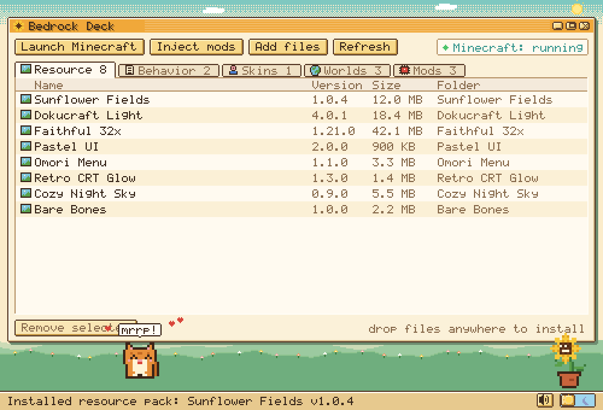
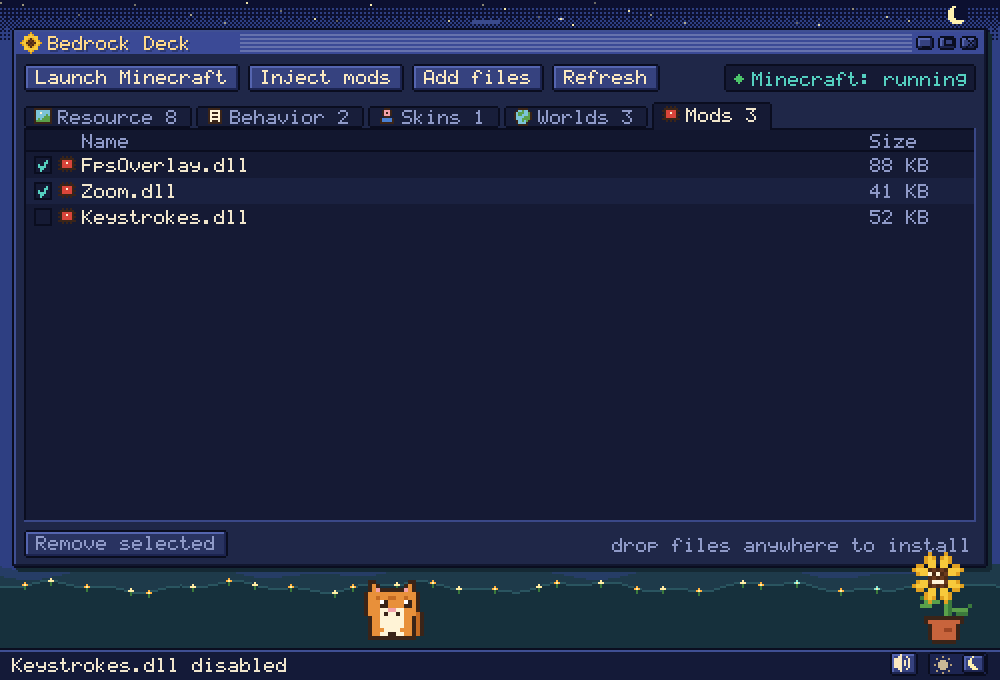
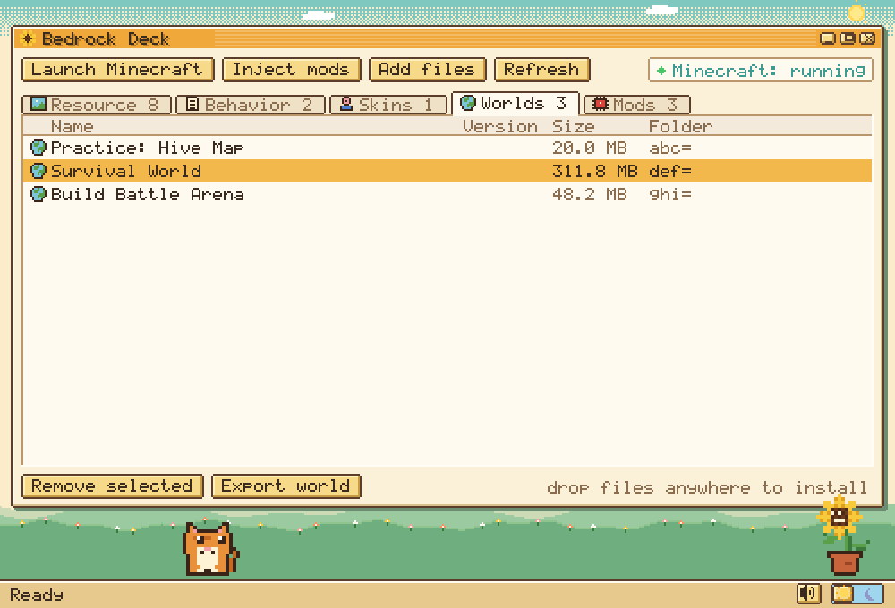

# bedrockdeck

A cozy pixel-art desktop app for managing **Minecraft: Bedrock Edition**: packs, skins, worlds and mods, with a built-in mod loader.
One small `.exe`, no installer, no dependencies. Written in C++17 with a hand-made pixel renderer.




## Features
- **Drag and drop install**: drop `.mcpack`, `.mcaddon`, `.mcworld` or `.mctemplate` files onto the window
- Tabs for **resource packs, behavior packs, skin packs, worlds and mods**, with names, versions and sizes
- **Little friends**: a cat that blinks, follows your cursor along the ground, hops after it, naps when you're idle, and meows when you click it; and a sunflower that turns its face toward the mouse and bounces when clicked. They cheer when an install works
- **Clicky sounds** for buttons, tabs, checkboxes and the pets (all synthesized in code, nothing to download), with a mute button
- **Day / night switch** at the bottom: a warm sunflower-and-cream light theme and a midnight-indigo night theme with stars. Your choice is remembered
- **Safe by design**: installs are all-or-nothing, existing worlds are never overwritten, malicious archives that try to write outside the Minecraft folder are rejected, and worlds are backed up automatically before they are deleted
- **Export worlds** as `.mcworld` files
- **Mods**: add `.dll` mods, tick the ones you want, and load them into the running game with one click
- Launch Minecraft from the app
- Command line for scripting (`bedrockdeck list`, `install`, `export`, ...)

## Download
Get the latest build from the [Releases page](../../releases), extract the zip, and double-click `bedrockdeck.exe`.
Windows may show a SmartScreen warning because the exe is unsigned: click **More info → Run anyway**.

## Using it
1. Run `bedrockdeck.exe`. If it can't find your Minecraft data folder it asks you to pick your `com.mojang` folder.
2. Drag pack, world or mod files onto the window, or click **Add files**.
3. Click an item, then **Remove selected** (or press Delete), or **Export world** on the Worlds tab. Arrow keys move the selection and F5 refreshes.
4. To use mods: click **Launch Minecraft**, wait for the title screen, tick your mods in the **Mods** tab, then click **Inject mods**.
5. Click the sun / moon switch at the bottom right to change the theme, and the speaker to mute sounds.



### Command line
```
bedrockdeck list
bedrockdeck install MyPack.mcpack Cool.mcworld
bedrockdeck export "<world-folder>"
bedrockdeck remove resource "<folder>"
bedrockdeck mods add MyMod.dll
bedrockdeck mods on MyMod.dll
bedrockdeck inject
bedrockdeck paths
```
Options: `--dir <com.mojang folder>`, `--data <bedrockdeck folder>`.

## About mods
bedrockdeck does not include any mods. A mod is a DLL you add yourself, and it runs inside the game, so **only use mods from sources you trust**.
Many servers ban modified clients, so check a server's rules before joining with mods loaded. Practising offline in your own worlds is always safe.
The loader only ever targets `Minecraft.Windows.exe`, only loads DLLs from bedrockdeck's own mods folder, and asks you to confirm before loading.

## Build from source
```bash
cmake -B build
cmake --build build --config Release
```
Binary: `build/Release/bedrockdeck.exe` (Visual Studio) or `build/bedrockdeck`. On Linux/macOS only the command-line pack manager is built (useful for development); the window, launching and mod loading are Windows-only.

## How it works
- The whole interface is drawn by a tiny **software pixel renderer** (rectangles, dithered gradients, a 5x7 bitmap font, sprites) at a low virtual resolution and scaled up with crisp pixels. The interface logic never touches Windows, so it was tested by rendering frames to images and simulating mouse clicks
- The pets are small state machines (sit, hop, happy, sleep) driven by the mouse position
- Sounds are generated at startup by a small synthesizer and played from memory
- A from-scratch **DEFLATE decompressor** and **ZIP reader/writer** (packs and worlds are zip files)
- A tolerant **JSON parser** for `manifest.json` (accepts the comments and trailing commas Minecraft allows)
- A Windows **mod loader**: grants the DLL read access for app packages, then loads it into the game with `LoadLibraryW` via a remote thread

## Layout
```
include/deck/canvas.hpp      pixel canvas, bitmap font, sprite drawing
include/deck/sprites.hpp     pixel art (cat, flower pot, icons)
include/deck/theme.hpp       light and dark color schemes
include/deck/ui.hpp          the interface: layout, widgets, input, scrolling
include/deck/pets.hpp        cat, sunflower, particles
include/deck/sfx.hpp         sound synthesizer
include/deck/gui_win.hpp     Windows window host (blits the frame, forwards input, plays sounds)
include/deck/app.hpp         settings and state shared by window and CLI
include/deck/inflate.hpp     DEFLATE decompressor
include/deck/zip.hpp         ZIP reader and writer
include/deck/json.hpp        JSON parser
include/deck/packs.hpp       find Minecraft folders, list/install/remove/export
include/deck/mods.hpp        mods folder and enabled list
include/deck/inject_win.hpp  launch + mod loader (Windows)
src/main.cpp                 entry point and command line
docs/                        screenshots
```

## License
MIT
